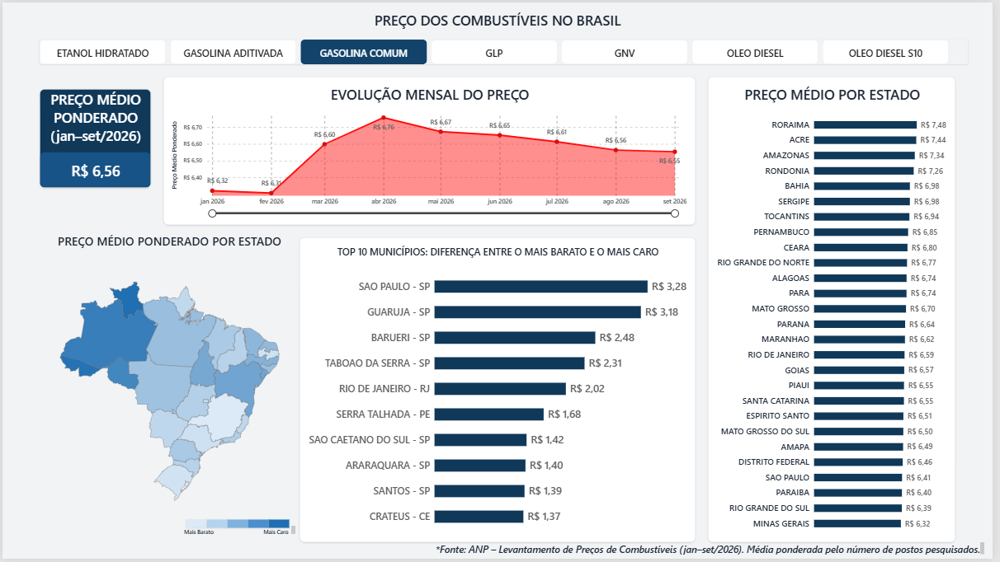
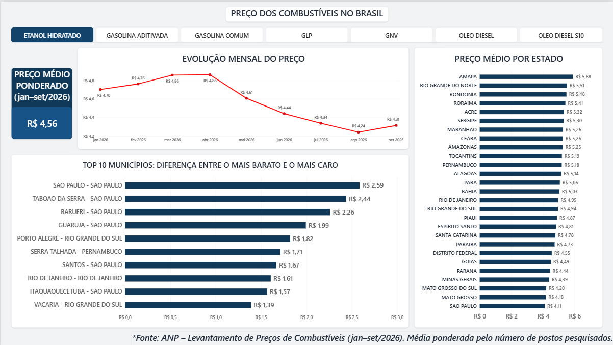

# ⛽ Análise de Preços de Combustíveis no Brasil (ANP, jan–set/2026)

Dashboard em **Power BI** que analisa os preços de revenda de combustíveis em 416 municípios brasileiros, a partir dos dados abertos da ANP.

## 🎯 Perguntas de negócio
1. Qual é o preço médio de cada combustível no período?
2. Como os preços evoluíram de janeiro a setembro de 2026?
3. Quais estados são os mais caros e os mais baratos?
4. Em quais municípios pesquisar preço gera mais economia para o motorista?

## 📊 Principais insights

**Gasolina comum**
- Preço médio ponderado no período: **R$ 6,56/litro**.
- **Pico em abril (R$ 6,76)**. De janeiro (R$ 6,32) a setembro (R$ 6,55), a alta foi de **3,6%**.
- A **Região Norte** concentra os preços mais altos: Roraima (R$ 7,48), Acre (R$ 7,44) e Amazonas (R$ 7,34). Minas Gerais teve a menor média (R$ 6,32).
- **São Paulo acompanha a tendência nacional, mas num patamar mais baixo** (R$ 6,41), o que sugere fatores nacionais nas variações e fatores locais no nível de preço.
- Na **capital paulista**, a diferença entre o posto mais caro e o mais barato chega a **R$ 3,28/litro**, contra R$ 0,62 na média dos municípios.

**Etanol hidratado**
- Preço médio ponderado no período: **R$ 4,56/litro**.
- **São Paulo tem o etanol mais barato do país (R$ 4,11)**, e o Amapá, o mais caro (R$ 5,88).
- O preço atingiu o pico em março/abril (R$ 4,86) e **caiu cerca de 13% até agosto (R$ 4,24)**. Hipótese: o início da safra de cana-de-açúcar no Centro-Sul, a partir de abril, aumenta a oferta de etanol.

## ⚠️ Limitações e notas de análise
- A média é **ponderada pelo número de postos pesquisados**, pois a base não traz o volume vendido.
- A **amplitude** (máximo − mínimo) tende a ser maior em cidades com mais postos pesquisados (ex.: São Paulo, com ~909 postos/mês, x Crateús/CE, com ~32). Por isso, o dashboard mostra o tamanho da amostra na dica de ferramenta.
- GLP (R$/13 kg) e GNV (R$/m³) têm unidades diferentes dos combustíveis líquidos (R$/litro). Por isso, o filtro de produto exige **seleção única**: o relatório nunca mistura unidades numa mesma média.

## 🛠️ Etapas do projeto
- **Power Query:** limpeza de um relatório "de impressão" (remoção de cabeçalhos, colunas vazias e ajuste de tipos); criação da chave `Município - Estado` (para separar municípios homônimos, como Valença/BA e Valença/RJ), da coluna "Grupo Combustível" e de colunas de exibição (`UF`, `Município - UF` e nomes de estados para o mapa) com tabelas de-para em linguagem M.
- **Modelagem:** esquema estrela com a tabela fato `fPrecos` e as dimensões `dLocal` e `dProduto`, a partir de uma consulta base com carga desabilitada.
- **DAX:** medidas com `SUMX`, `DIVIDE`, `AVERAGEX` e `COUNTROWS`; colunas calculadas com `SWITCH` e `IF`.
- **Visualização e design:** tema personalizado (`tema_anp_claro.json`), segmentação de botões com seleção única forçada, rankings com filtro Top N, detalhamento de estado para município, mapa de preços por estado, dicas de ferramenta com contexto e interações por filtragem cruzada.

## 📁 Fonte dos dados
ANP – Agência Nacional do Petróleo, Gás Natural e Biocombustíveis. *Levantamento de Preços de Combustíveis*, síntese mensal por município, jan–set/2026. [Dados abertos da ANP](https://www.gov.br/anp/pt-br/centrais-de-conteudo/dados-abertos/serie-historica-de-precos-de-combustiveis).

## 👤 Autor
**Cássio Plens Gouvêa** – Administrador (UFMS), com experiência em almoxarifado, compras e logística.
[LinkedIn](https://www.linkedin.com/in/cassiogouvea)
